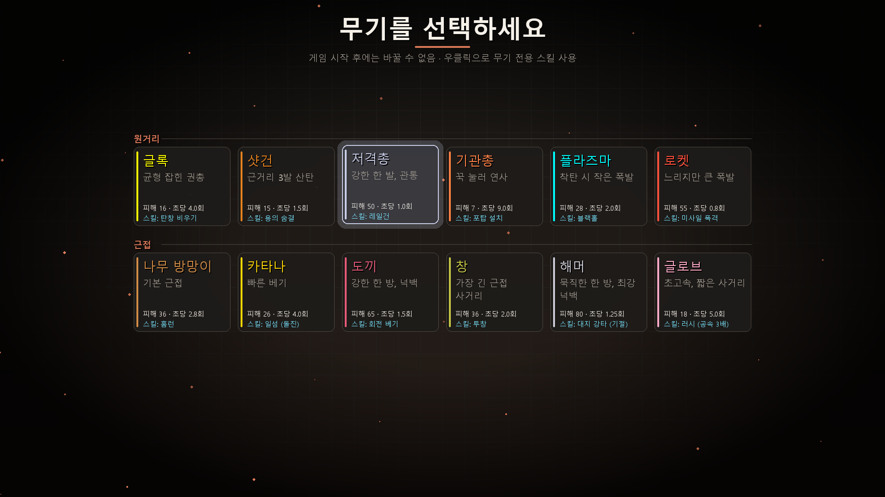
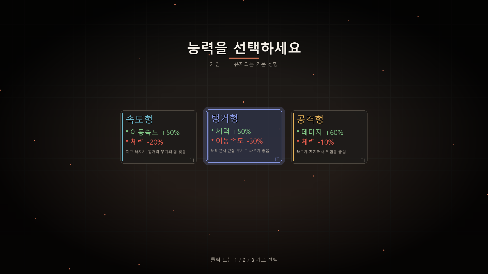
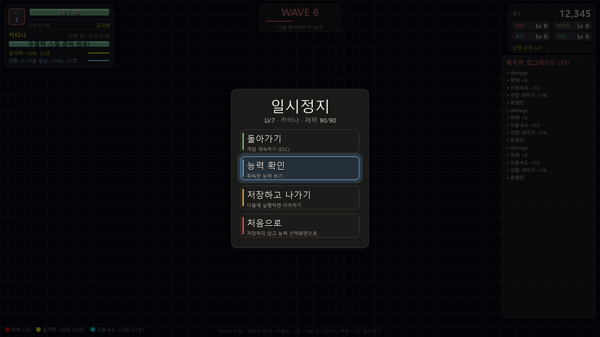
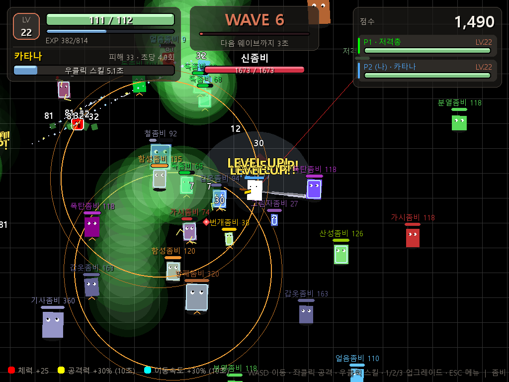

# 좀비 슈팅 게임 (Zombie Survival)

끝없이 몰려오는 좀비를 무찌르며 최대한 오래 살아남는 pygame 탑다운 서바이벌 슈팅 게임입니다.
1인용과 LAN 멀티(최대 4명)를 지원합니다.

## 다운로드 / 실행

- [Releases](../../releases) 에서 `좀비게임.exe`(1인용), `좀비멀티.exe`(LAN 멀티)를 받아 실행하면 됩니다. 파이썬 설치 필요 없음.
- 소스로 실행: `pip install pygame` 후 `python ZZ1.py` (1인용) / `python 좀비멀티.py` (멀티)

## 특징

- 무기 12종 (원거리 6 · 근접 6), 무기마다 고유 우클릭 스킬
- 50종 이상의 좀비와 보스 (신좀비의 12사도 · 12천사 등)
- 레벨업 업그레이드, 속성탄(화염/얼음/전기), 아이템 드롭
- 저장하고 이어하기
- LAN 멀티: 락스텝 동기화, 좀비 수 = 1인 기준 × 인원 × 1.1, 쓰러지면 3웨이브 뒤 부활

## 조작

| 키 | 동작 |
|---|---|
| WASD | 이동 |
| 좌클릭 | 공격 |
| 우클릭 | 무기 스킬 |
| 1 / 2 / 3 | 업그레이드 선택 |
| TAB | 업그레이드 목록 |
| ESC | 일시정지 |

| | |
|---|---|
|  |  |
|  | |

자세한 내용은 [게임 가이드](좀비게임_가이드.md)를 참고하세요.
